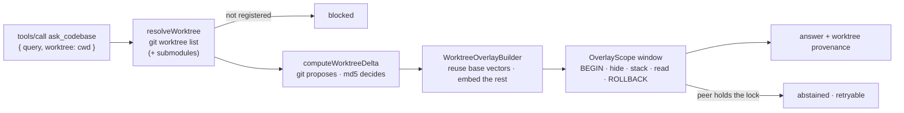

# ADR-038 — A worktree is an overlay on the repository's one index

| | |
|---|---|
| **Category** | Retrieval · MCP · Workspace · Concurrency |
| **Author** | David Balladares (decision) · Claude (design, implementation, record) |
| **Date** | 2026-10-22 |
| **Status** | ✅ **Accepted** |
| **Amends** | [ADR-024](./ADR-024-umbra-as-a-read-only-mcp-server.md) constraint 3 (see its 2026-10-22 amendment) |
| **Preserves** | [ADR-030](./ADR-030-discovery-based-indexing-and-decision-catalogs.md): one root still owns one `.umbra/` index |

## Context

David works through Claude Code with many agents in parallel, each in its own
git worktree. Umbra could not see any of them.

**Umbra answered about the main checkout to every agent.** Claude Code starts one
MCP process per session, and subagents share it: *"String references share the
parent session's connection"* (code.claude.com/docs/en/sub-agents, read
2026-10-22). That process receives the session's start directory as
`CLAUDE_PROJECT_DIR`, and for a desktop worktree session the docs say
*"`${CLAUDE_PROJECT_DIR}` points at"* the main checkout's root
(code.claude.com/docs/en/worktrees). `roots/list` returns *"the session's launch
directory plus every additional working directory you've granted with
`--add-dir`"* (code.claude.com/docs/en/mcp). No `tools/call` carries the
caller's working directory. Umbra pins its root from exactly those sources, once
(`resolveMcpProjectRoot` in `src/presentation/mcp/project-root.ts`), so an agent
in `.claude/worktrees/<name>/` got answers about another branch. Its own edits
and new files were invisible.

Measured live on 2026-10-22: five `umbra mcp --auto-root` processes were running
on this machine, three of them for the same repository
(`/home/david/projects/londonuw/luone`). All three had that main checkout as
both working directory and `CLAUDE_PROJECT_DIR`. The repository had ten git
worktrees, and none of them had an index.

**Indexing each worktree is the obvious fix and the wrong one.** That
repository's index held 8,417 files and 53,267 chunks (about 480 MB on the copy
measured). The worktrees differ from it by a few dozen files at most: the
largest delta measured, `.worktrees/pbi-dash`, was 86 changed files and one
deleted. Re-embedding 53,267 chunks per worktree to capture 86 files repeats
work 600 times over. And nothing could be shared across copies: `code_chunks.id`
is a random UUID and `chunk_vectors` is keyed by it.

**The repository is a superproject.** Its submodules (`LONDONUW-AGENTS-DASHBOARD`,
`LONDONUW-AGENTS-LOGIN-API`, `LONDONUW-ZOHO-API-MANAGER`, and two more) are
indexed as part of it, because discovery walks into them. Most parallel work
happens in worktrees *of a submodule*: 12 of the 17 entries under its
`.worktrees/` have a gitdir under `.git/modules/<submodule>/worktrees/`. The
superproject's own `git worktree list` never shows them.

## Decision

**Index by content, query by worktree.** The repository keeps its one base index.
A caller may name the worktree it works in. Umbra then answers as if that
worktree had been indexed: it hides the base index's rows for every path the
worktree changes or lacks, and stacks the worktree's own rows on top, for the
duration of one read and never on disk.

This is the pattern established code indexers already use, and Umbra builds none
of its parts from scratch:

- **Glean** (Meta) answers queries over an incremental database by hiding the
  base's facts for changed units and stacking new facts on top: *"To produce a
  modified DB, we hide a portion of the data in the original DB, and then stack
  a DB with the new data on top"*, and *"the fact that the DB is a stack is
  invisible to a user making queries"* (glean.software/blog/incremental, read
  2026-10-22).
- **Zoekt** (Sourcegraph) indexes many branches of one repository once: *"Each
  file blob in the index has a bitmask, representing the branches in which the
  content is found"* (github.com/sourcegraph/zoekt, `doc/design.md`).
- **Cursor** finds changed files with *"a cryptographic hash of every file"* and
  *"caches embeddings by chunk content"* (cursor.com/blog/secure-codebase-indexing).
- **Git** itself: every worktree shares one object store and owns only its head
  and its index.

### 1. The trust boundary is the repository, not one directory

`resolveWorktree` in `src/core/config/git-worktrees.ts` accepts an absolute path
(the caller's working directory, or any directory inside it) and selects the
worktree it belongs to. It accepts only:

- a worktree `git worktree list --porcelain -z` reports for the pinned root, or
  for one of its submodules that is initialised there
  (`readInitialisedSubmodules`);
- the submodule's own checkout, added explicitly, because git lists a
  submodule's main worktree as its gitdir under `.git/modules/<name>` rather
  than as the directory it is checked out in;
- compared after `realpath` on both sides, the longest matching root winning,
  because Claude Code's worktrees live inside the main checkout;
- only when `git rev-parse --git-common-dir` of the selection equals that of the
  repository that listed it, so a worktree directory replaced by a symlink to
  another checkout is refused.

Anything else is `WORKTREE_NOT_REGISTERED`. The pinned root is still pinned at
launch, and no argument can make Umbra serve another repository (ADR-024's
2026-10-22 amendment).

Two rules were added after review, both reproduced on fixtures first:

- **A submodule must really be this repository's.** Its declared path must be a
  real directory inside the pinned root, not a symlink (`lstat`). Its
  `--git-common-dir` must also lie inside the pinned root or inside the pinned
  repository's own common dir, which is where git absorbs submodules, under
  `modules/`. Before this rule, a `.gitmodules` path that was a symlink to
  another repository made that repository selectable (`isOwnSubmodule`).
- **The served root must be the top level of its repository.** When Umbra is
  pinned to a subdirectory (a monorepo package with its own `package.json`),
  every worktree root lies above it, so a selection would widen the server to
  its siblings. That is refused as `WORKTREE_PINNED_SUBDIRECTORY`, not mapped:
  no measured case pins a subdirectory, and mapping would need every git path
  rebased, because porcelain paths are relative to the top level.

### 2. Git proposes, the content hash decides

`computeWorktreeDelta` in `src/core/rag/worktree-delta.ts` asks git which paths
*could* differ from the base index, then compares each candidate with
`file_registry.hash`, the index's own definition of a changed file. The proposals
are:

- the worktree's `git --no-optional-locks status --porcelain=v1 -z
  --untracked-files=all --no-renames`, and the repository checkout's;
- `git diff --name-only --no-renames -z` between the repository checkout's head
  and the worktree's, and between the head the index was built at and the
  worktree's;
- the paths the last index run saw uncommitted or left pending, recorded in the
  stamp's new `git` field (`IndexedGitState` in `src/core/rag/index-stamp.ts`,
  written by `captureIndexedGitState` and `mergeIndexedGitState` in
  `src/core/rag/indexed-git-state.ts`);
- every indexed path git does not track, because discovery never reads
  `.gitignore`.

`--no-optional-locks` matters: a plain `git status` refreshes the index and takes
`index.lock`, and run on every call it would race the agent's own `git add` in
that worktree. `--no-renames` makes a rename a deletion plus an addition, so the
old path's base rows are hidden.

Three rules decide the edge cases:

- **An ignored file is changed, never deleted.** The last proposal is a file git
  ignores: a generated client, a nested repository, a scratch copy. Such a file
  belongs to a checkout's environment, not to the branch. A worktree that has
  not produced it has not deleted it, so the base's version stays visible until
  the worktree holds one of its own. Treating these as deletions was measured
  first: that repository's index held 8,417 untracked paths, 7,109 of them under
  `.worktrees/`, and the rule hid all of them from every worktree at 120–200 ms
  per call.
- **In the repository's own checkout, ignored files are not re-checked.** They
  are the files the index was read from. Hashing them anyway cost 550 ms per
  call to find edits the no-argument path does not see either.
- **A symlink is never read.** A candidate is read only when `lstat` says it is
  a regular file whose `realpath` stays inside the worktree. Discovery already
  skips symlinks; an indexed path replaced by one is hidden (ADR-011). The read
  itself opens the checked path with `O_NOFOLLOW` and checks the descriptor
  (`readRegularFileNoFollow`), so a file swapped for a symlink after the check
  is refused too.
- **A submodule a superproject worktree has checked out is asked directly.**
  The superproject's status names only the submodule's gitlink, and its
  `ls-files` lists none of the submodule's files. So each submodule the
  worktree has initialised gets its own status and head diff
  (`initialisedSubmoduleProposals`). Without that, a file deleted in it would
  be treated as an ignored artifact and stay visible.

A path the index has never held enters the overlay only if discovery would index
it in the worktree (`discoveredScope`), so a new spec or a file outside every
tsconfig is not source. Discovery takes half a second on that repository, so it
runs only when such a path appears. Its answer is cached until the head, the set
of new paths, or the size or mtime of one of them changes: a tsconfig edited
twice stays in the set, and its second edit can bring a file into scope. A `git
diff` that fails, for example by timing out under load, is never cached as
"nothing changed".

For a submodule's worktree, every path is translated by the worktree's
`indexPrefix`: `src/a.ts` there is `LONDONUW-AGENTS-DASHBOARD/src/a.ts` in the
index. The stamp's git state describes the pinned repository only, so it is not
used for a submodule.

### 3. The overlay is a cache, built from the base index itself

`WorktreeOverlayBuilder` in `src/core/rag/worktree-overlay.ts` parses each changed
file with the indexer's own code and keeps the result in memory, keyed by the
delta's `signature`.

- **One definition of a file's rows.** `IndexerService.indexSingleFile` was split
  so that `analyzeSourceFile`, `commitIndexedFile`, `commitSkippedFile` and
  `commitGraphOnlyFile` in `src/core/rag/indexed-file-rows.ts` define the rows a
  file contributes, for the base index and the overlay alike. A copy of those
  INSERTs in the overlay would drift, and every drift would be a worktree answer
  that silently differs from an indexed one.
- **Files are parsed in the worktree's own paths, then moved to the index's.**
  `NestChunker` is rooted at the worktree so imports resolve against its files,
  and `relocate` then applies the submodule prefix.
- **An unchanged chunk is never re-embedded.** Before calling the provider,
  `vectorsFor` reuses any base vector whose chunk, at the same path, has an
  identical embedding input (`embeddingInputFor`), then a process memo keyed by
  provider, model and input. Only the remaining inputs are embedded.
- **The graph tools need no provider.** With `embed: false` the overlay carries
  registry, dependency and NestJS rows only.

### 4. The stack lives in a transaction that is always rolled back

`OverlayScope` in `src/core/rag/overlay-scope.ts` owns a second better-sqlite3
connection to the same `.umbra/memory.db`, with its own sqlite-vec load
(`loadVectorExtensionInto`: the extension loads per connection, and
`loadVectorExtension` memoizes per process). For each read, serialized:

1. `BEGIN IMMEDIATE`;
2. `DROP TRIGGER code_chunks_fts_delete`, then delete the hidden chunks' FTS rows
   by rowid, then delete their `file_registry` rows and let the foreign-key
   cascades remove chunks, vectors, dependency edges and NestJS rows;
3. write the worktree's rows through `commitIndexedFile` (a savepoint inside the
   open transaction);
4. run the read on this connection;
5. `ROLLBACK`, in a `finally`.

Every existing query then answers about the worktree without a line of it
changing. That covers FTS5 `bm25` with the real corpus statistics, the
unknown-term vocabulary of ADR-028 (a term that lived only in a hidden file is
gone), cosine distance, the dependency and NestJS graphs, and skeletons. Nothing
is ever committed. Other connections keep their committed snapshot (WAL
isolation), so no other caller, in this process or another, sees a worktree's
rows. A crash discards the transaction.

**The trigger is dropped because it scans.** `code_chunks_fts.chunk_id` is
UNINDEXED, so the delete trigger scans the whole FTS table once per deleted
chunk: 11,523 ms for 147 chunks on a 47,775-chunk copy (measured 2026-10-22).
The rowids are looked up before the window instead (one scan, cached per path
set) and re-validated inside it, where the snapshot can no longer move. The same
deletion then took 4 ms. The rollback restores the trigger.

**The window does no I/O.** The transaction holds SQLite's write lock, and
better-sqlite3 waits for a lock synchronously, blocking its event loop. A window
that awaited anything could freeze the very loop it needs to finish, and writers
in the other Umbra processes on the same index would hit their 5,000 ms busy
timeout. So inside the window only synchronous SQL runs, plus query embeddings
answered from a memo. When a query's embedding is not in the memo, the view
throws, the window rolls back, the text is embedded outside, and the read is
retried (at most three attempts: the query, and the clarified query). That
provider call runs outside the window and outside the per-process queue, which
is taken per window rather than per read. A slow embedding therefore never
delays another worktree read in the process, and the graph tools need no
provider at all. A `setImmediate` tripwire reports any window that outlived its
macrotask (`windowOutlivedMacrotask`). `ROLLBACK` runs only while a transaction
is still open, because SQLite rolls back by itself on some errors and a second
`ROLLBACK` would replace the real error. An extended `SQLITE_BUSY_*` code counts
as busy. The connection waits at most 1,000 ms for a peer's
lock and then reports `OverlayBusyError`. The scope refuses to open while this
process is indexing (`IndexerService.running`). And the singleton connection is
opened before the first window, so its schema writes never meet the lock.

### 5. The published surface

`ask_codebase`, `search_workspace`, `inspect_project`, `query_dependency_graph`,
`query_nest_graph` and `get_index_status` take an optional `worktree`
(`worktreeArgument` in `src/presentation/mcp/worktree-arguments.ts`). The server
instructions tell clients to pass their current working directory. Without the
argument, each tool behaves exactly as before.

- `ask_codebase` and the two graph tools read through the overlay.
  `search_workspace` and `inspect_project` are live filesystem reads, so they
  simply read the selected worktree, under the same containment rules.
- Every result carries an optional `worktree` provenance record (`toolWorktreeSchema`
  in `src/core/tools/tool-result.ts`): path, branch, head, `isPinnedRoot`,
  `indexPrefix` for a submodule, changed and deleted file counts, chunks
  embedded and reused, and elapsed time. Index evidence keeps the index's paths.
- A busy lock is an abstention with `retryable: true` and code
  `WORKTREE_OVERLAY_BUSY` in its diagnostic, the same rule ADR-024's 2026-09-21
  amendment applies to a warming index. A path outside the repository's
  worktrees is `blocked`.
- An alias learned from a worktree answer is never staged for the base index,
  because it could name paths only that worktree has.
- `worktree-view.ts` is required lazily (`loadWorktreeViews`), which keeps the
  overlay modules off the path to the handshake (ADR-024 amendment 15). Review
  found that this does not keep the *indexer* off it: the `core/tools` barrel
  already reaches it at startup through `file-tools.ts`. That is older than
  this decision and is left to its own change.

## DDD layer mapping

| Layer | Component | Role |
|---|---|---|
| Infrastructure | `src/core/config/git-worktrees.ts` | Git as the authority on which worktrees exist and what changed |
| Infrastructure | `src/core/rag/worktree-delta.ts`, `worktree-overlay.ts`, `overlay-scope.ts`, `indexed-file-rows.ts` | Delta, overlay cache, scoped SQLite window, shared row writes |
| Application | `src/core/rag/worktree-view.ts` — `WorktreeViewService` | Sequences resolve → delta → build → scoped read |
| Application | `src/core/tools/read-only-executions.ts` — `executeCodebaseSearch`, `executeDependencyGraph`, `executeNestGraph` | Accept a scope or a connection; results unchanged otherwise |
| Presentation | `src/presentation/mcp/tool-catalog.ts`, `worktree-arguments.ts` | The `worktree` argument, refusals, provenance |

## Alternatives

| Option | Why it lost |
|---|---|
| One `.umbra/` per worktree | A full index and re-embed per worktree, 53,267 chunks to capture 86 files; lost when the worktree is removed; three processes would still each build it |
| Temp views over the base plus a separate FTS table for the overlay | FTS5 `bm25` statistics are per table, so a small overlay corpus ranks its own chunks low; a term that lived only in a hidden base file stays in the vocabulary, so ADR-028's abstention would be wrong in exactly the changed files |
| Copy the database per worktree | About 480 MB per copy on that repository |
| Read the worktree from MCP Roots or `CLAUDE_PROJECT_DIR` | Both name the main checkout (Context); no per-call signal exists |
| A file watcher | It does not say which worktree is asking, and would watch ten trees on WSL |
| Hash every file instead of asking git | Exact without git, but the full inspection is 401 ms on this repository (ADR-024 amendment 16) and proportionally more on a large one |
| Hold the lock across the query embedding | A slow provider call would hold every peer's writes past their busy timeout (found by review before implementation); replaced by abort, embed outside, retry |
| Treat an ignored indexed file the worktree lacks as deleted | Measured: hid 8,417 paths from every worktree, at 120–200 ms per call |
| Content-addressed chunk ids in the base schema | Would let any copy share vectors by content, but needs a migration; reuse by lookup at the same path covers the measured case. Deferred (`docs/deferred-work.md`) |
| One shared server per repository (gopls `-remote=auto`) | Saves memory and shares the overlay cache across sessions; does not change any answer. Deferred |

## Consequences

### Positive

- An agent in any worktree, including a submodule's, gets answers about its own
  files: new files, edits, deletions, and the main checkout's uncommitted work
  correctly absent.
- No index is created per worktree, and the base index is never written by a
  read.
- The overlay reuses what the base index already paid for. In the live run
  below, the edited file's unchanged chunks kept their base vectors (3 reused,
  3 embedded). On the 86-file delta, 193 of 783 chunks were reused.
- Every answer says which worktree it describes and what that cost.

### Neutral

- Without `worktree`, every tool behaves exactly as before. That includes the
  base index's own staleness, which ADR-024 amendment 16 reports through
  `indexedAt`.
- Passing the main checkout's own path gives a live view of it too. Its
  uncommitted edits made after indexing are stacked like a worktree's, because
  git reports them.
- Index evidence keeps the index's paths. For a submodule's worktree, the client
  strips `worktree.indexPrefix`.

### Negative — accepted honestly

- **The first call after many changes is slow.** On `.worktrees/pbi-dash`
  (86 changed files, 25 of them new, 783 chunks), the first build reused 193
  vectors and embedded 590, in 22.5 s with Ollama `nomic-embed-text`. The next
  call took 0 ms. The memo lives in each process, so each of three processes on
  one repository pays it once, and a restart pays it again. A persistent
  content-keyed vector cache or a shared server would remove that (deferred).
- **Every worktree read takes the index's write lock** for the window: 23–32 ms
  to stack 21 files on that repository's copy. Peers' writes wait for it. A read
  that meets a peer's lock for more than 1,000 ms abstains and asks to be
  retried.
- **A worktree read costs a git status.** About 30 ms of the 30–40 ms delta on
  that repository, on every call.
- **Not every tool takes `worktree` yet.** `investigate_graphrag`, `list_adrs`,
  `run_integrity_check` and `continue_conversation` still read the pinned root
  (deferred).
- **Some ignored artifacts stay stale in a worktree.** An ignored file the base
  index holds and the worktree has not produced is served in the base's
  version, by design. In the repository's own checkout, an ignored file edited
  after indexing is not detected, which is the existing behaviour.
- **The stamp's git state describes the pinned repository only.** For a
  submodule's worktree, commits made in the submodule's checkout after indexing
  are found through its current head and status, not through the stamp, so a
  `git pull` in the submodule without a re-index is served as the base's
  version, the same staleness the no-argument path has. Recording a state per
  submodule would cost two git calls per submodule on every index run, and the
  CLI re-indexes after every write.
- **One read can race a peer's re-index.** The delta is computed before the
  window, and the window stacks on the latest committed snapshot. If, in
  between, a peer re-indexes a file that the worktree had unchanged and the
  main checkout then edited, that one read serves the main checkout's new
  version. The next read recomputes. Only the hidden rows' rowids are
  re-validated inside the window.
- **Each index run now spawns git**: a head and a status at the start, and again
  at the end when files were processed. The recorded uncommitted paths are
  limited to discovered source, so a checkout with many untracked non-source
  files does not grow the stamp.

## Verification Evidence

- Unit and integration specs, all run on 2026-10-22 against real git
  repositories and real SQLite (no mocks of either):
  - `src/core/config/git-worktrees.spec.ts`: parsing; selection of the pinned
    root, a nested Claude Code worktree and a subdirectory; refusal of relative,
    missing, outside, symlinked, `..` and foreign-repository paths, and of a git
    failure.
  - `src/core/rag/worktree-delta.spec.ts`: ignored artifacts, renames, a touched
    and restored file, a symlink, discovery scope for new files, the signature,
    a main-checkout draft, and `mergeIndexedGitState`.
  - `src/core/rag/worktree-view.spec.ts`: an index-only term found only through
    the worktree; a term the worktree deleted abstaining; the main checkout's
    uncommitted edit absent from a worktree; the base fingerprint (counts, every
    hash, the trigger) unchanged after reads; vector reuse and zero embeddings
    on a repeat; one macrotask per window once the query embedding is known;
    the worktree's dependency graph with no embedding; the overlay invisible to
    the singleton connection mid-read; rollback when the read throws; busy
    reported against a held lock; and on a superproject, selection of a
    submodule's worktree and of the submodule's own checkout, with answers in
    the index's paths.
  - `src/presentation/mcp/tool-catalog.spec.ts`: exactly the six tools above
    publish an optional `worktree`.
  - Added after review, each run first against the previous commit to see it
    fail. In `git-worktrees.spec.ts`: a submodule path that is a symlink to
    another repository, a submodule `.git` file pointing at one, and a
    subdirectory pin (3 failed before the fix, 0 after). In
    `worktree-delta.spec.ts`: a file deleted inside a superproject worktree's
    submodule, and a tsconfig edited twice (2 failed before). In
    `worktree-view.spec.ts`: a graph read made while another read waits on its
    query embedding (1 failed before, because the old queue held the provider
    call).
- **Review before the PR:** four sasori, one lens each (concurrency, security,
  delta correctness, no-argument regressions). Their findings and what was done
  with each are listed in the PR body.
- **Live, through the compiled binary.** `node dist/bin/cli.js mcp --root
  <clone>` was driven over stdio JSON-RPC on a clone of this repository, with
  Ollama `nomic-embed-text`. In its worktree, one file gained a function and one
  file was added:
  - *okapi sightings habitat ledger*: base abstained on unknown terms; worktree
    `success` with `src/core/rag/okapi-ledger.ts`;
  - *zebrafish regeneration stability*: base abstained on all three terms;
    worktree abstained on `stability` alone, which no file contains as a word.
    That is ADR-028's strict rule working on the overlay's vocabulary;
  - *reciprocal rank fusion …*: both `success`, same top files;
  - first worktree call 434 ms (3 chunks embedded, 3 reused), repeats 43–59 ms;
    base calls 6–45 ms;
  - `/etc` refused as not registered; `search_workspace` found the new class
    only with `worktree`; `get_index_status` reported 2 changed files.
- **On the large repository, read-only or on a copy:**
  - delta per worktree 30–40 ms warm (first call 50–160 ms), of which `git
    status` was about 30 ms;
  - `.worktrees/pbi-dash` resolved with prefix `LONDONUW-AGENTS-DASHBOARD`, 86
    changed and 1 deleted; `.worktrees/mqr-api/src` resolved to its
    `LONDONUW-AGENTS-LOGIN-API` worktree, 26 changed;
  - window on a backup copy of its index, 21 files and 110 chunks stacked:
    23–32 ms, or 64–82 ms with two full-table counts as the read. After five
    windows, the file, chunk and FTS counts were identical and the trigger was
    present.

### Not verified

- A real Claude Code agent passing `worktree` on its own, from the server
  instructions alone. Only the driver above has called it.
- Contention with peer processes writing the same index during a window. The
  busy path is covered by a spec that holds the lock on another connection.
- `windowOutlivedMacrotask` on the large repository's search path. It is
  asserted on the fixture only.

## Related Files

- `src/core/config/git-worktrees.ts` — `resolveWorktree`, `listGitWorktrees`, `parseWorktreeList`, `readInitialisedSubmodules`, `readGitStatusPaths`, `readGitTrackedPaths`, `readGitHead`, `WorktreeResolutionError`
- `src/core/rag/worktree-delta.ts` — `computeWorktreeDelta`, `DeltaFile`, `WorktreeDelta`, `untrackedIndexedPaths`, `containedRegularFile`, `ancestorsExist`, `discoveredScope`
- `src/core/rag/worktree-overlay.ts` — `WorktreeOverlayBuilder`, `relocate`, `OverlayFile`
- `src/core/rag/overlay-scope.ts` — `OverlayScope`, `OverlayBusyError`, `OverlayView`, `OverlayScopeStats`
- `src/core/rag/worktree-view.ts` — `WorktreeViewService`, `worktreeViews`, `provenanceOf`
- `src/core/rag/indexed-file-rows.ts` — `analyzeSourceFile`, `commitIndexedFile`, `commitSkippedFile`, `commitGraphOnlyFile`
- `src/core/rag/indexed-git-state.ts` — `captureIndexedGitState`, `mergeIndexedGitState`
- `src/core/rag/index-stamp.ts` — `IndexStamp.git`, `IndexedGitState`
- `src/core/rag/indexer.ts` — `IndexerService.indexSingleFile`, `IndexerService.running`, the stamp writes in `indexDiscoveredProject`
- `src/core/rag/retriever.ts` — `RetrieverOptions`, `RetrieverService` constructor
- `src/core/state/vector-extension.ts` — `loadVectorExtensionInto`
- `src/core/tools/read-only-executions.ts` — `WorktreeIndexScope`, `executeCodebaseSearch`, `executeDependencyGraph`, `executeNestGraph`, `isRetryableRead`
- `src/core/tools/tool-result.ts` — `toolWorktreeSchema`, `ToolWorktree`
- `src/presentation/mcp/worktree-arguments.ts` — `worktreeArgument`, `selectWorktree`
- `src/presentation/mcp/tool-catalog.ts` — the six tools' `worktree` handling
- `src/presentation/mcp/start-mcp-server.ts` — the server instructions
- `src/core/config/git-worktrees.spec.ts`, `src/core/rag/worktree-delta.spec.ts`, `src/core/rag/worktree-view.spec.ts`, `src/presentation/mcp/tool-catalog.spec.ts`
